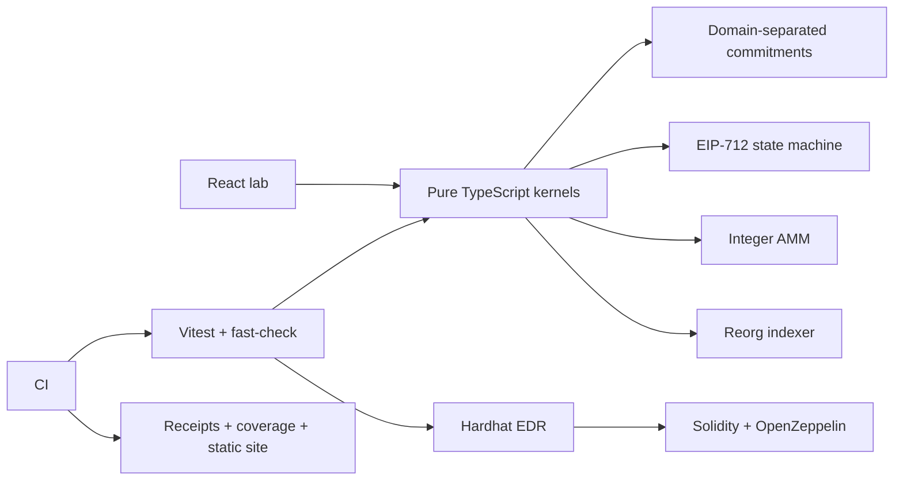

# Architecture & boundaries

| Decision | Reason | Boundary |
|---|---|---|
| BigInt amounts | Deterministic integer arithmetic | Raw units; no market prices |
| Domain-separated, ordered Merkle tree | Bind leaf order and length; distinguish leaf/internal/root | Not interchangeable with the OZ distributor's sorted-pair, double-hash format |
| EIP-712 + chain + contract + nonce + deadline | Bind authorization and prevent replay | In-memory EOA ledger; no ERC-1271 or RPC |
| Validate, then commit | Failed operations preserve prior state | Single-process execution; not a distributed database |
| Snapshots by block parent | Atomic rollback and deterministic replay | O(chain state) snapshots; no persistence/pruning; caller selects canonical branch |
| Static equal-weight quorum | Expose the >2/3 threshold and duplicate-vote rules | Votes are assumed authenticated; no networking, PoS, view-change locks or liveness guarantee |
| Raw CIDv1 / SHA-256 | Content-addressed integrity from bytes | No IPFS upload, UnixFS chunking or availability guarantee |
| Full-state rollup witness | Inspectable one-step verification | Not succinct, not ZK, no settlement contract/bridge/DA protocol |
| OpenZeppelin primitives | Standard token semantics and access controls | Educational composition; not audited |
| CEI + reentrancy guard | Protect accounting at callback boundaries | Standard ETH/ERC-20 model; rebasing/fee-on-transfer assets excluded |
| Owner-scheduled timelock | Delayed, cancelable authority | No token voting or decentralization claim |
| Issuer-attested ERC-721 | Commit a submission evidence hash | Transferable NFT; does not prove current holder's skill or automatic grading |

Threats exercised: adversarial input, forged inclusion, signature replay/domain substitution, callback reentrancy, rejected transfers, equivocation, duplicate logs, fork rollback and early/repeated execution. Finality, issuer honesty and external data availability remain explicit assumptions.

Source specifications: [EIP-712](https://eips.ethereum.org/EIPS/eip-712), [ERC-20](https://eips.ethereum.org/EIPS/eip-20), [ERC-721](https://eips.ethereum.org/EIPS/eip-721), [CID](https://github.com/ipfs/specs/blob/main/src/cid.md), [CometBFT](https://github.com/cometbft/cometbft/blob/main/spec/consensus/consensus.md), [OpenZeppelin](https://docs.openzeppelin.com/contracts/5.x/), [GitHub Pages workflow](https://docs.github.com/en/pages/getting-started-with-github-pages/using-custom-workflows-with-github-pages).
